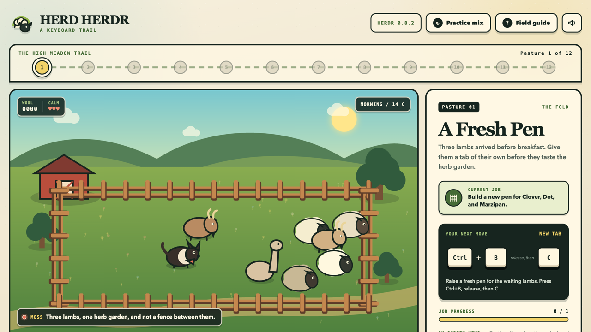
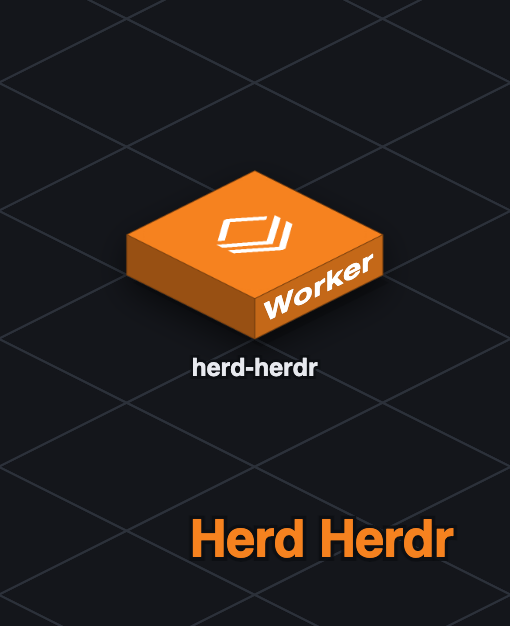
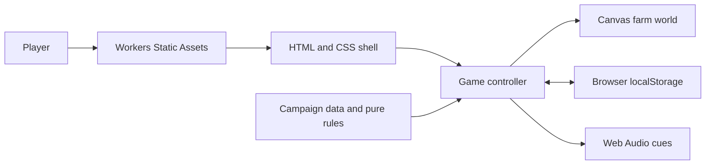

# Herd Herdr

[](https://deploy.workers.cloudflare.com/?url=https://github.com/Gryczka/herd-herdr)
[](LICENSE)

> A browser game for learning practical keyboard shortcuts through a playful herding campaign.

> **Status:** This is a reference implementation shared as-is. It is not actively maintained; support is best-effort via [GitHub Issues](https://github.com/Gryczka/herd-herdr/issues).

**[Play the live demo](https://herd-herdr.dwarven.workers.dev)**



Herd Herdr teaches the default [Herdr](https://herdr.dev/) terminal shortcuts through a 12-level pastoral adventure. Help Moss the border collie organize sheep, goats, fields, tabs, panes, and workspaces using the same prefix sequences Herdr accepts in a real terminal.

## Table of Contents

- [Architecture](#architecture)
- [Features](#features)
- [Tech Stack](#tech-stack)
- [Prerequisites](#prerequisites)
- [Getting Started](#getting-started)
- [Configuration](#configuration)
- [Usage](#usage)
- [Project Structure](#project-structure)
- [Contributing](#contributing)
- [License](#license)
- [Acknowledgments](#acknowledgments)

## Architecture





Cloudflare Workers serves the dependency-free application as static assets. In the browser, a DOM controller combines testable campaign rules with the canvas renderer, optional sound, and local-only progress; there is no application server or database.

## Features

- Twelve freely selectable feature lessons based on Herdr 0.8.2 defaults
- Real `Ctrl+B` prefix practice for tabs, panes, workspaces, navigation, and session actions
- Interactive tab and workspace naming prompts that mirror Herdr's default flow
- Randomized mixed-practice runs after the campaign
- Animated Canvas farm with sheep, goats, an alpaca, weather, and night scenes
- Physical keyboard and touch-friendly on-screen controls
- Local progress, stars, wool score, and optional synthesized sound
- Accessible canvas descriptions, live feedback, keyboard operation, and reduced-motion support
- Static deployment with no Worker script, bindings, or backend services

## Tech Stack

| Layer        | Technology                       |
| ------------ | -------------------------------- |
| Language     | Modern JavaScript ES modules     |
| Interface    | Semantic HTML and responsive CSS |
| Illustration | Canvas 2D API                    |
| Persistence  | Browser localStorage             |
| Audio        | Web Audio API                    |
| Hosting      | Cloudflare Workers Static Assets |
| Testing      | Vitest                           |
| Quality      | ESLint and Prettier              |

## Prerequisites

- Node.js 22 or newer
- npm
- A Cloudflare account and Wrangler login only when deploying your own copy

## Getting Started

### Clone the Repository

```sh
git clone https://github.com/Gryczka/herd-herdr.git
cd herd-herdr
```

### Install Dependencies

```sh
npm install
```

The game does not require environment variables or external services.

### Run the Application

```sh
npm run dev
```

Open the local URL printed by Wrangler, normally `http://localhost:8787`.

### Verify Changes

```sh
npm run check
```

This runs linting, all unit tests, and a Wrangler deployment dry run.

## Configuration

`wrangler.jsonc` defines a static-assets-only Worker:

```jsonc
{
	"$schema": "node_modules/wrangler/config-schema.json",
	"name": "herd-herdr",
	"compatibility_date": "2026-08-31",
	"assets": {
		"directory": "./public",
	},
}
```

No Worker script or bindings are required. To deploy under a specific Cloudflare account without committing its account ID, set `CLOUDFLARE_ACCOUNT_ID` for the command:

```sh
CLOUDFLARE_ACCOUNT_ID="your-account-id" npm run deploy
```

Otherwise, run `npm run deploy` and select from the accounts available to your Wrangler login.

## Usage

1. Start with the new-tab lesson or choose any feature from the lesson strip.
2. Enter the displayed Herdr sequence on a physical keyboard, such as `Ctrl+B`, release, then `C`.
3. On touch devices, tap `Ctrl+B` and then the highlighted action key.
4. Complete lessons in any order and replay them to improve their star result.
5. Open **Practice mix** for a randomized ten-command session.
6. Open **Field guide** for a compact shortcut reference.

Campaign progress stays in the current browser. Reset it from the field guide whenever you want to begin again.

## Project Structure

```text
herd-herdr/
|-- public/
|   |-- index.html       Application structure and dialogs
|   |-- styles.css       Pastoral visual system and responsive layout
|   |-- game-core.js     Campaign data and testable keyboard rules
|   |-- game.js          Input, scoring, persistence, sound, and UI control
|   |-- farm-world.js    Canvas illustration and animation engine
|   `-- favicon.svg      Project mark
|-- test/
|   `-- game-core.spec.js
|-- docs/screenshots/
|   `-- demo.png         Live application screenshot
|-- .github/             CI, issue forms, and pull request template
|-- wrangler.jsonc       Static Assets deployment configuration
|-- eslint.config.js
|-- vitest.config.js
`-- package.json
```

The campaign reflects Herdr 0.8.2 defaults. Inside Herdr, use `prefix+?` to inspect the bindings active for your own configuration.

## Contributing

Contributions are welcome. Read the [Contributing Guide](CONTRIBUTING.md) for development setup, quality checks, and the pull request process. Participation is governed by the [Code of Conduct](CODE_OF_CONDUCT.md).

## License

This project is licensed under the MIT License. See [LICENSE](LICENSE) for details.

## Acknowledgments

- [Herdr](https://herdr.dev/) for the terminal workflow and shortcut vocabulary
- [Cloudflare Workers](https://developers.cloudflare.com/workers/) for static application hosting
